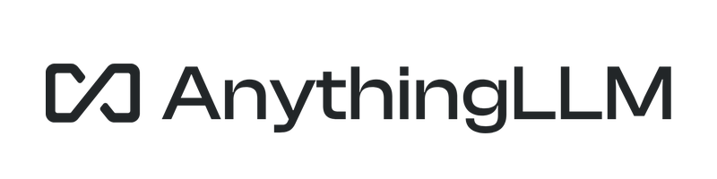
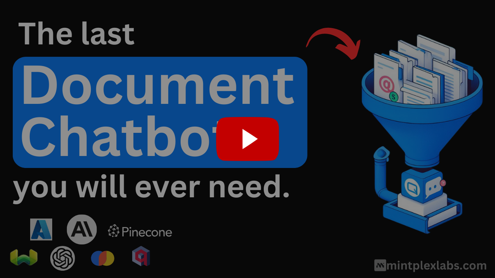

  

    <b>AnythingLLM:</b> تطبيق الذكاء الاصطناعي المتكامل الذي كنت تبحث عنه. 
    تحدّث مع مستنداتك، واستخدم وكلاء الذكاء الاصطناعي، مع قابلية عالية للتخصيص ودعم لتعدد المستخدمين، ودون أي إعداد مرهق.

   |
   |
   |
  <a href="https://docs.anythingllm.com" target="_blank">
    التوثيق
  </a> |
   <a href="https://my.mintplexlabs.com/aio-checkout?product=anythingllm" target="_blank">
    نسخة مستضافة
  </a>

  <a href='../README.md'>English</a> · <a href='./README.zh-CN.md'>简体中文</a> · <a href='./README.ja-JP.md'>日本語</a> · <a href='./README.tr-TR.md'>Türkçe</a> · <a href='./README.fa-IR.md'>فارسی</a> · <b>العربية</b>

👈 AnythingLLM لسطح المكتب (Mac وWindows وLinux)! <a href="https://anythingllm.com/download" target="_blank"> نزّله الآن</a>

📱 تطبيق AnythingLLM Mobile (Android) مفتوح المصدر! <a href="https://github.com/Mintplex-Labs/anythingllm-mobile" target="_blank">اطّلع على المستودع</a>

تحدّث مع مستنداتك. أتمتة سير العمل المعقّد باستخدام وكلاء الذكاء الاصطناعي. قابل للتخصيص بدرجة عالية، وجاهز لتعدد المستخدمين، ومُجرَّب في بيئات الاستخدام الفعلي — ويعمل محليًا بشكل افتراضي دون أي عناء في الإعداد.

<kbd>شاهد العرض التوضيحي!</kbd>

### نظرة عامة على المنتج

AnythingLLM هو تطبيق الذكاء الاصطناعي المتكامل الذي يتيح لك بناء نسخة خاصة ومتكاملة الميزات من ChatGPT دون أي تنازلات. اربط نموذج LLM المفضل لديك، المحلي أو السحابي، واستورد مستنداتك، وابدأ المحادثة خلال دقائق. تحصل مباشرةً على وكلاء مدمجين، ودعم تعدد المستخدمين، وقواعد بيانات متجهية، وخطوط معالجة للمستندات — دون أي إعداد إضافي.

يدعم AnythingLLM كذلك تعدد المستخدمين، ويمكنك التحكم في صلاحيات الوصول وتجربة كل مستخدم دون المساس بأمن النسخة أو خصوصيتها أو ملكيتك الفكرية.

## ميزات AnythingLLM المميزة

- [محرك LLM محلي مدمج](../docker/HOW_TO_USE_DOCKER.md#built-in-llm-engine-optional) - شغّل النماذج المحلية على المعالج (CPU) أو بطاقة الرسوميات (GPU) (بطاقات NVIDIA عبر CUDA، وبطاقات AMD وIntel عبر Vulkan) دون أي إعداد إضافي، بالاعتماد على [Lemonade](https://lemonade-server.ai) و[llama.cpp](https://github.com/ggml-org/llama.cpp).
- [التوجيه الديناميكي للنماذج](https://docs.anythingllm.com/model-router/overview) - وجّه المحادثات تلقائيًا إلى أنسب مزوّد ونموذج لكل محادثة بحسب القواعد التي تحددها.
- [الذاكرة التلقائية والمُدارة من المستخدم](https://docs.anythingllm.com/features/memories) - اجعل نموذج LLM يتذكر المعلومات المهمة عنك أو عن مساحة عملك.
- [المهام المجدولة](https://docs.anythingllm.com/scheduled-jobs/overview) - شغّل مهامًا أو موجّهات (prompts) متكررة وفق جدول cron بكامل قدرات الوكيل.
- [الاختيار الذكي للمهارات](https://docs.anythingllm.com/agent/intelligent-tool-selection) فعّل عددًا **غير محدود** من الأدوات لنماذجك مع خفض استهلاك الرموز (tokens) بنسبة تصل إلى 80% لكل استعلام
- [منشئ وكلاء الذكاء الاصطناعي دون كتابة شيفرة](https://docs.anythingllm.com/agent-flows/overview)
- [التوافق مع MCP](https://docs.anythingllm.com/mcp-compatibility/overview)
- [دعم الوسائط المتعددة (للنماذج المغلقة والمفتوحة المصدر على حد سواء!)](https://docs.anythingllm.com/features/language-models)
- [وكلاء ذكاء اصطناعي مخصصون](https://docs.anythingllm.com/agent/custom/introduction)
- 👤 دعم النسخة متعددة المستخدمين وإدارة الصلاحيات _نسخة Docker فقط_
- 🎨 [سمات ألوان مخصصة وعلامة تجارية بيضاء (white-labeling)](https://docs.anythingllm.com/features/branding) - اختر لوحة ألوان مدمجة مثل True Dark أو أنشئ لوحتك الخاصة من ألوان علامتك التجارية، وطبّقها على جميع مستخدمي نسختك. _نسخة Docker فقط_
- 🦾 وكلاء داخل مساحة عملك (تصفح الويب وغير ذلك)
- 💬 [أداة محادثة مضمَّنة وقابلة للتخصيص لموقعك الإلكتروني](https://github.com/Mintplex-Labs/anythingllm-embed/blob/main/README.md) _نسخة Docker فقط_
- 📖 دعم أنواع متعددة من المستندات (PDF وTXT وDOCX وغيرها)
- واجهة محادثة سهلة الاستخدام مع الرفع بالسحب والإفلات والاستشهاد بالمصادر.
- جاهز للإنتاج في أي بيئة نشر سحابية.
- يعمل مع جميع [مزوّدي نماذج LLM الشائعين، المغلقة والمفتوحة المصدر](#supported-llms-embedder-models-speech-models-and-vector-databases).
- تحسينات مدمجة لمجموعات المستندات الكبيرة — تكلفة أقل واستجابات أسرع من واجهات المحادثة الأخرى.
- واجهة برمجية كاملة للمطورين (Developer API) لإنشاء تكاملات مخصصة!
- ...والمزيد — ثبّته خلال دقائق وجرّب بنفسك.

### نماذج LLM ونماذج التضمين ونماذج الكلام وقواعد البيانات المتجهية المدعومة

**النماذج اللغوية الكبيرة (LLMs):**

- [أي نموذج مفتوح المصدر متوافق مع llama.cpp](../server/storage/models/README.md#text-generation-llm-selection)
- [OpenAI](https://openai.com)
- [OpenAI (عام)](https://openai.com)
- [Azure OpenAI](https://azure.microsoft.com/en-us/products/ai-services/openai-service)
- [AWS Bedrock](https://aws.amazon.com/bedrock/)
- [Anthropic](https://www.anthropic.com/)
- [NVIDIA NIM (نماذج المحادثة)](https://build.nvidia.com/explore/discover)
- [Google Gemini Pro](https://ai.google.dev/)
- [Ollama (نماذج المحادثة)](https://ollama.ai/)
- [LM Studio (جميع النماذج)](https://lmstudio.ai)
- [LocalAI (جميع النماذج)](https://localai.io/)
- [Together AI (نماذج المحادثة)](https://www.together.ai/)
- [Fireworks AI (نماذج المحادثة)](https://fireworks.ai/)
- [Perplexity (نماذج المحادثة)](https://www.perplexity.ai/)
- [OpenRouter (نماذج المحادثة)](https://openrouter.ai/)
- [DeepSeek (نماذج المحادثة)](https://deepseek.com/)
- [Mistral](https://mistral.ai/)
- [Groq](https://groq.com/)
- [Cohere](https://cohere.com/)
- [KoboldCPP](https://github.com/LostRuins/koboldcpp)
- [LiteLLM](https://github.com/BerriAI/litellm)
- [Text Generation Web UI](https://github.com/oobabooga/text-generation-webui)
- [Apipie](https://apipie.ai/)
- [xAI](https://x.ai/)
- [Z.AI (نماذج المحادثة)](https://z.ai/model-api)
- [Novita AI (نماذج المحادثة)](https://novita.ai/model-api/product/llm-api?utm_source=github_anything-llm&utm_medium=github_readme&utm_campaign=link)
- [PPIO](https://ppinfra.com?utm_source=github_anything-llm)
- [Gitee AI](https://ai.gitee.com/)
- [Moonshot AI](https://www.moonshot.ai/)
- [Microsoft Foundry Local](https://github.com/microsoft/Foundry-Local)
- [CometAPI (نماذج المحادثة)](https://www.cometapi.com/)
- [llmman](https://github.com/llmmanorg/llmman)
- [PrivateModeAI (نماذج المحادثة)](https://privatemode.ai/)
- [SambaNova Cloud (نماذج المحادثة)](https://cloud.sambanova.ai/)
- [Lemonade by AMD](https://lemonade-server.ai)
- [Minimax](https://platform.minimax.io)
- [Cerebras (نماذج المحادثة)](https://www.cerebras.ai/)
- [oMLX](https://github.com/jundot/omlx)

**نماذج التضمين (Embedder):**

- [المضمِّن الأصلي في AnythingLLM](../server/storage/models/README.md) (افتراضي)
- [OpenAI](https://openai.com)
- [Azure OpenAI](https://azure.microsoft.com/en-us/products/ai-services/openai-service)
- [Gemini](https://ai.google.dev/)
- [LocalAI (الكل)](https://localai.io/)
- [Ollama (الكل)](https://ollama.ai/)
- [LM Studio (الكل)](https://lmstudio.ai)
- [Lemonade](https://lemonade-server.ai)
- [OpenRouter](https://openrouter.ai/)
- [LiteLLM](https://github.com/BerriAI/litellm)
- [Cohere](https://cohere.com/)
- [Voyage AI](https://www.voyageai.com/)
- [Mistral](https://mistral.ai/)
- واجهات تضمين عامة متوافقة مع OpenAI

**نماذج تفريغ الصوت إلى نص (Audio Transcription):**

- [المدمج في AnythingLLM](https://github.com/Mintplex-Labs/anything-llm/tree/master/server/storage/models#audiovideo-transcription) (افتراضي)
- [OpenAI](https://openai.com/)

**دعم TTS (تحويل النص إلى كلام):**

- المدمج في المتصفح (افتراضي)
- [PiperTTSLocal - يعمل داخل المتصفح](https://github.com/rhasspy/piper)
- [OpenAI TTS](https://platform.openai.com/docs/guides/text-to-speech#voice-options)
- [ElevenLabs](https://elevenlabs.io/)
- أي خدمة TTS متوافقة مع OpenAI.

**دعم STT (تحويل الكلام إلى نص):**

- المدمج في المتصفح (افتراضي)

**قواعد البيانات المتجهية:**

- [LanceDB](https://github.com/lancedb/lancedb) (افتراضي)
- [PGVector](https://github.com/pgvector/pgvector)
- [Astra DB](https://www.datastax.com/products/datastax-astra)
- [Pinecone](https://pinecone.io)
- [Chroma & ChromaCloud](https://trychroma.com)
- [Weaviate](https://weaviate.io)
- [Qdrant](https://qdrant.tech)
- [Milvus](https://milvus.io)
- [Zilliz](https://zilliz.com)

### نظرة تقنية عامة

يتكوّن هذا المستودع الموحَّد (monorepo) من ستة أقسام رئيسية:

- `frontend`: واجهة أمامية مبنية بـ viteJS وReact، يمكنك تشغيلها لإنشاء وإدارة كل المحتوى الذي يستطيع نموذج LLM استخدامه بسهولة.
- `server`: خادم NodeJS express يتولى جميع التفاعلات، وإدارة قاعدة البيانات المتجهية، والتعامل مع نماذج LLM.
- `collector`: خادم NodeJS express يعالج المستندات الواردة من الواجهة ويحلّلها.
- `docker`: تعليمات Docker وعملية البناء + معلومات البناء من المصدر.
- `embed`: وحدة فرعية (submodule) لتوليد وإنشاء [أداة المحادثة القابلة للتضمين في الويب](https://github.com/Mintplex-Labs/anythingllm-embed).
- `browser-extension`: وحدة فرعية لـ[إضافة متصفح Chrome](https://github.com/Mintplex-Labs/anythingllm-extension).

## 🛳 الاستضافة الذاتية

تتولى Mintplex Labs والمجتمع صيانة عدد من طرق النشر والسكربتات والقوالب التي يمكنك استخدامها لتشغيل AnythingLLM محليًا. راجع الجدول أدناه لمعرفة كيفية النشر في بيئتك المفضلة أو للنشر تلقائيًا.

| Docker | AWS | GCP | Digital Ocean | Render.com |
|----------------------------------------|----|-----|---------------|------------|
| [![النشر على Docker][docker-btn]][docker-deploy] | [![النشر على AWS][aws-btn]][aws-deploy] | [![النشر على GCP][gcp-btn]][gcp-deploy] | [![النشر على DigitalOcean][do-btn]][do-deploy] | [![النشر على Render.com][render-btn]][render-deploy] |

| Railway                                             | RepoCloud                                                 | Elestio                                             | Northflank                                                   | Sealos                                           |
| --------------------------------------------------- | --------------------------------------------------------- | --------------------------------------------------- | ------------------------------------------------------------ | ------------------------------------------------ |
| [![النشر على Railway][railway-btn]][railway-deploy] | [![النشر على RepoCloud][repocloud-btn]][repocloud-deploy] | [![النشر على Elestio][elestio-btn]][elestio-deploy] | [![النشر على Northflank][northflank-btn]][northflank-deploy] | [![النشر على Sealos][sealos-btn]][sealos-deploy] |

| Easypanel                                                 |
| --------------------------------------------------------- |
| [![النشر على Easypanel][easypanel-btn]][easypanel-deploy] |

[أو أعدّ نسخة إنتاجية من AnythingLLM دون Docker →](../BARE_METAL.md)

## كيفية الإعداد للتطوير

- `yarn setup` لتعبئة ملفات `.env` المطلوبة في كل قسم من أقسام التطبيق (من جذر المستودع).
  - املأها قبل المتابعة. تأكّد من تعبئة `server/.env.development`، وإلا فلن تعمل الأمور كما ينبغي.
- `yarn dev:server` لتشغيل الخادم محليًا (من جذر المستودع).
- `yarn dev:frontend` لتشغيل الواجهة الأمامية محليًا (من جذر المستودع).
- `yarn dev:collector` لتشغيل مُجمِّع المستندات (document collector) بعد ذلك (من جذر المستودع).

[تعرّف على المستندات](../server/storage/documents/DOCUMENTS.md)

## القياس عن بُعد والخصوصية

يتضمن AnythingLLM من Mintplex Labs Inc ميزة قياس عن بُعد (Telemetry) تجمع معلومات استخدام مجهولة الهوية.

<kbd>المزيد عن القياس عن بُعد والخصوصية في AnythingLLM</kbd>

### لماذا؟

نستخدم هذه المعلومات لفهم كيفية استخدام AnythingLLM، ولترتيب أولويات العمل على الميزات الجديدة وإصلاح الأخطاء، ولتحسين أداء AnythingLLM واستقراره.

### كيف تُعطّله؟

اضبط `DISABLE_TELEMETRY` على "true" في إعدادات .env الخاصة بالخادم أو Docker لإيقاف القياس عن بُعد. يمكنك أيضًا فعل ذلك من داخل التطبيق: من الشريط الجانبي > `Privacy` ثم تعطيل القياس عن بُعد.

### ما الذي نتتبّعه تحديدًا؟

نتتبّع فقط تفاصيل الاستخدام التي تساعدنا في اتخاذ قرارات المنتج وخارطة الطريق، وهي تحديدًا:

- نوع تثبيتك (Docker أو Desktop)

- عند إضافة مستند أو إزالته. لا نجمع أي معلومات _عن_ المستند نفسه، بل فقط وقوع الحدث. وهذا يعطينا فكرة عن مدى الاستخدام.

- نوع قاعدة البيانات المتجهية المستخدمة. يساعدنا ذلك على ترتيب أولويات التغييرات عند صدور تحديثات لذلك المزوّد.

- نوع مزوّد LLM ووسم النموذج المستخدم. يساعدنا ذلك على ترتيب أولويات التغييرات عند صدور تحديثات لذلك المزوّد أو النموذج أو لمزيج منهما. مثال: نماذج الاستدلال مقابل النماذج العادية، والنماذج متعددة الوسائط، وغيرها.

- عند إرسال محادثة. هذا هو "الحدث" الأكثر تكرارًا، ويعطينا فكرة عن النشاط اليومي لهذا المشروع عبر جميع عمليات التثبيت. ومرة أخرى، يُرسَل **الحدث** فقط — ولا نملك أي معلومات عن طبيعة المحادثة أو محتواها.

يمكنك التحقق من هذه الادعاءات بالعثور على جميع المواضع التي يُستدعى فيها `Telemetry.sendTelemetry`. كما تُكتب هذه الأحداث في سجل المخرجات، فيمكنك أيضًا الاطلاع على البيانات المحددة التي أُرسلت — إن كان ذلك مفعّلًا. **لا يُجمع أي عنوان IP أو أي معلومات أخرى تعرّف بالهوية**. مزوّد القياس عن بُعد هو [PostHog](https://posthog.com/) — وهي خدمة مفتوحة المصدر لجمع بيانات القياس عن بُعد.

نأخذ الخصوصية على محمل الجد، ونأمل أن تتفهّم رغبتنا في معرفة كيفية استخدام أداتنا دون اللجوء إلى استبيانات منبثقة مزعجة، حتى نبني شيئًا يستحق الاستخدام. لا تُشارَك البيانات المجهولة مع أي طرف ثالث إطلاقًا.

[عرض جميع أحداث القياس عن بُعد في الشيفرة المصدرية](https://github.com/search?q=repo%3AMintplex-Labs%2Fanything-llm%20.sendTelemetry(&type=code)

### اتصالات صادرة أخرى

إذا عطّلت القياس عن بُعد، فستظل ترى اتصالات صادرة إلى الخدمات التالية:

- عند استخدام أداة خارجية أو نموذج LLM أو نماذج تضمين أو قواعد بيانات متجهية، ستظل ترى اتصالات صادرة إلى مزوّد الخدمة المعني.
- `cdn.anythingllm.com` لسحب النماذج من شبكة CDN الخاصة بنا (نسخة مرآة mirror). لا يتتبّع القياس عن بُعد هذا الاتصال، وهو مفيد فعلًا لمن يقيمون في المناطق التي تفرض قيودًا على VPN.
- `github/githubusercontent.com` تُنزَّل بعض الملفات النصية المسطّحة من هذين النطاقين لتخزين نافذة السياق مؤقتًا.

باختصار، إذا كان القياس عن بُعد معطّلًا فلا نجمع أي شيء. ومع ذلك، بحسب إعداداتك قد تظل ترى اتصالات صادرة، وتخضع حينها لشروط الخدمة الخاصة بمزوّد الخدمة المعني.

## 👋 المساهمة

- [المساهمة في AnythingLLM](../CONTRIBUTING.md) - كيفية المساهمة في AnythingLLM.

## 💖 الرعاة

<!--
### Premium Sponsors
premium-sponsors (reserved for $100/mth sponsors who request to be called out here and/or are non-private sponsors) -->
<!-- premium-sponsors -->

### جميع الرعاة

<!-- all-sponsors --><!-- all-sponsors -->

## 🌟 المساهمون

## 🔗 منتجات أخرى

- **[AnythingLLM Mobile (بترخيص مفتوح المصدر)][anythingllm-mobile]:** تجربة AnythingLLM نفسها على الجهاز، ولكن على هاتفك.
- **[إضافة متصفح AnythingLLM][anythingllm-extension]:** إضافة للمتصفح تتيح لك استخدام AnythingLLM داخل متصفحك.
- **[AnythingLLM Embed][anythingllm-embed]:** أداة تتيح لك تضمين AnythingLLM في موقعك الإلكتروني.
- **[Open Computer][open-computer]:** بيئة حاسوب كاملة يستخدمها وكلاء الذكاء الاصطناعي.

[![][back-to-top]](#readme-top)

---

حقوق النشر © 2026 [Mintplex Labs][profile-link].  
هذا المشروع مرخَّص بموجب رخصة [MIT](../LICENSE).

<!-- LINK GROUP -->

[back-to-top]: https://img.shields.io/badge/-BACK_TO_TOP-222628?style=flat-square
[profile-link]: https://github.com/mintplex-labs
[anythingllm-mobile]: https://github.com/Mintplex-Labs/anythingllm-mobile
[anythingllm-extension]: https://github.com/Mintplex-Labs/anythingllm-extension
[anythingllm-embed]: https://github.com/Mintplex-Labs/anythingllm-embed
[open-computer]: https://github.com/Mintplex-Labs/open-computer
[docker-btn]: ../images/deployBtns/docker.png
[docker-deploy]: ../docker/HOW_TO_USE_DOCKER.md
[aws-btn]: ../images/deployBtns/aws.png
[aws-deploy]: ../cloud-deployments/aws/cloudformation/DEPLOY.md
[gcp-btn]: https://deploy.cloud.run/button.svg
[gcp-deploy]: ../cloud-deployments/gcp/deployment/DEPLOY.md
[do-btn]: https://www.deploytodo.com/do-btn-blue.svg
[do-deploy]: ../cloud-deployments/digitalocean/terraform/DEPLOY.md
[render-btn]: https://render.com/images/deploy-to-render-button.svg
[render-deploy]: https://render.com/deploy?repo=https://github.com/Mintplex-Labs/anything-llm&branch=render
[render-btn]: https://render.com/images/deploy-to-render-button.svg
[render-deploy]: https://render.com/deploy?repo=https://github.com/Mintplex-Labs/anything-llm&branch=render
[railway-btn]: https://railway.app/button.svg
[railway-deploy]: https://railway.app/template/HNSCS1?referralCode=WFgJkn
[repocloud-btn]: https://d16t0pc4846x52.cloudfront.net/deploylobe.svg
[repocloud-deploy]: https://repocloud.io/details/?app_id=276
[elestio-btn]: https://elest.io/images/logos/deploy-to-elestio-btn.png
[elestio-deploy]: https://elest.io/open-source/anythingllm
[northflank-btn]: https://assets.northflank.com/deploy_to_northflank_smm_36700fb050.svg
[northflank-deploy]: https://northflank.com/stacks/deploy-anythingllm
[sealos-btn]: https://sealos.io/Deploy-on-Sealos.svg
[sealos-deploy]: https://sealos.io/products/app-store/anything-llm
[easypanel-btn]: https://easypanel.io/img/deploy-on-easypanel-40.svg
[easypanel-deploy]: https://easypanel.io/templates/anythingllm

ترجمة: فريق مُشَيِّد

