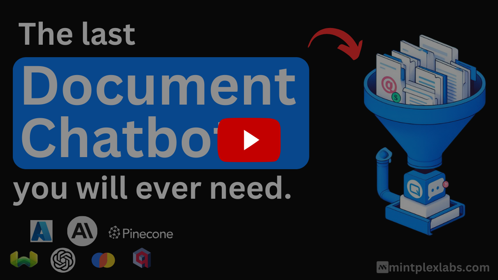

  

    <b>AnythingLLM:</b> Aplikasi AI serba ada yang selama ini Anda cari. 
    Berbicara dengan dokumen Anda, gunakan AI Agent, mudah untuk dikonfigurasi, mendukung multi-user, dan tanpa proses persiapan yang merepotkan.

   |
   |
  <a href="https://docs.anythingllm.com" target="_blank">
    Dokumentasi
  </a> |
   <a href="https://my.mintplexlabs.com/aio-checkout?product=anythingllm" target="_blank">
    Instance Terkelola
  </a>

  <a href='../README.md'>English</a> · <a href='./README.zh-CN.md'>简体中文</a> · <a href='./README.ja-JP.md'>日本語</a> · <a href='./README.tr-TR.md'>Türkçe</a> · <a href='./README.fa-IR.md'>فارسی</a> · <b>Bahasa Indonesia</b>

👉 AnythingLLM untuk desktop (Mac, Windows, & Linux)! <a href="https://anythingllm.com/download" target="_blank">Unduh Sekarang</a>

📱 AnythingLLM Mobile (Android) kini open source! <a href="https://github.com/Mintplex-Labs/anythingllm-mobile" target="_blank">Lihat repositorinya</a>

Berbicara dengan dokumen Anda. Otomatiskan alur kerja yang kompleks dengan AI Agent. Sangat mudah untuk dikonfigurasi, mendukung multi-user, teruji di lapangan dan secara default berjalan secara lokal tanpa persiapan yang merepotkan.

<kbd>Tonton demonya!</kbd>

### Ikhtisar Produk

AnythingLLM adalah aplikasi AI serba ada yang memungkinkan Anda membangun ChatGPT pribadi dengan fitur lengkap—tanpa kompromi. Hubungkan LLM lokal atau cloud favorit Anda, masukkan dokumen Anda, dan mulai percakapan dalam hitungan menit. Langsung tersedia tanpa konfigurasi tambahan: agent bawaan, dukungan multi-user, database vektor, dan pipeline dokumen.

AnythingLLM juga mendukung multi-user, di mana Anda dapat mengatur akses dan pengalaman untuk setiap pengguna tanpa mengorbankan keamanan atau privasi instance maupun kekayaan intelektual Anda.

## Fitur-Fitur Keren AnythingLLM

- [Mesin LLM lokal bawaan](../docker/HOW_TO_USE_DOCKER.md#built-in-llm-engine-optional) - Jalankan model lokal di CPU atau GPU Anda (NVIDIA melalui CUDA, AMD dan Intel melalui Vulkan) tanpa penyiapan tambahan, didukung oleh [Lemonade](https://lemonade-server.ai) dan [llama.cpp](https://github.com/ggml-org/llama.cpp).
- [Perutean Model Dinamis](https://docs.anythingllm.com/model-router/overview) - Arahkan obrolan secara otomatis ke model & penyedia model terbaik untuk percakapan tersebut berdasarkan aturan yang Anda tentukan.
- [Memori Otomatis & yang Dikelola Pengguna](https://docs.anythingllm.com/features/memories) - Biarkan LLM Anda mengingat informasi penting tentang Anda atau workspace Anda.
- [Tugas Terjadwal](https://docs.anythingllm.com/scheduled-jobs/overview) - Jalankan tugas atau prompt berulang sesuai jadwal cron dengan kemampuan agent.
- [Pemilihan Skill Cerdas](https://docs.anythingllm.com/agent/intelligent-tool-selection) Aktifkan tool **tanpa batas** untuk model Anda sambil mengurangi penggunaan token hingga 80% per query
- [Pembuat AI Agent tanpa kode](https://docs.anythingllm.com/agent-flows/overview)
- [Kompatibel dengan MCP](https://docs.anythingllm.com/mcp-compatibility/overview)
- [Dukungan multi-modal (baik LLM closed-source maupun open-source!)](https://docs.anythingllm.com/features/language-models)
- [AI Agent khusus](https://docs.anythingllm.com/agent/custom/introduction)
- 👤 Dukungan instance multi-pengguna dan pengaturan izin _Khusus versi Docker_
- 🎨 [Tema warna khusus & white-labeling](https://docs.anythingllm.com/features/branding) - Pilih palet bawaan seperti True Dark atau buat sendiri dari warna merek Anda, lalu terapkan untuk semua pengguna di instance Anda. _Khusus versi Docker_
- 🦾 Agent di dalam workspace Anda (menjelajah web, dll)
- 💬 [Widget Chat yang dapat disematkan ke situs web Anda](https://github.com/Mintplex-Labs/anythingllm-embed/blob/main/README.md) _Khusus versi Docker_
- 📖 Dukungan berbagai jenis dokumen (PDF, TXT, DOCX, dll)
- Antarmuka chat yang intuitif dengan unggah drag-and-drop dan kutipan sumber.
- Siap produksi untuk deployment di cloud mana pun.
- Bekerja dengan semua [penyedia LLM closed-source dan open-source](#llm-model-embedder-model-suara-dan-database-vektor-yang-didukung) populer.
- Optimasi bawaan untuk kumpulan dokumen berukuran besar—biaya lebih rendah dan respons lebih cepat dibandingkan antarmuka chat lainnya.
- API Developer lengkap untuk integrasi khusus!
- ...dan masih banyak lagi—instal dalam hitungan menit dan buktikan sendiri.

### LLM, Model Embedder, Model Suara, dan Database Vektor yang Didukung

**Large Language Models (LLM):**

- [Model open-source apa pun yang kompatibel dengan llama.cpp](../server/storage/models/README.md#text-generation-llm-selection)
- [OpenAI](https://openai.com)
- [OpenAI (Generik)](https://openai.com)
- [Azure OpenAI](https://azure.microsoft.com/en-us/products/ai-services/openai-service)
- [AWS Bedrock](https://aws.amazon.com/bedrock/)
- [Anthropic](https://www.anthropic.com/)
- [NVIDIA NIM (model chat)](https://build.nvidia.com/explore/discover)
- [Google Gemini Pro](https://ai.google.dev/)
- [Ollama (model chat)](https://ollama.ai/)
- [LM Studio (semua model)](https://lmstudio.ai)
- [LocalAI (semua model)](https://localai.io/)
- [Together AI (model chat)](https://www.together.ai/)
- [Fireworks AI (model chat)](https://fireworks.ai/)
- [Perplexity (model chat)](https://www.perplexity.ai/)
- [OpenRouter (model chat)](https://openrouter.ai/)
- [DeepSeek (model chat)](https://deepseek.com/)
- [Mistral](https://mistral.ai/)
- [Groq](https://groq.com/)
- [Cohere](https://cohere.com/)
- [KoboldCPP](https://github.com/LostRuins/koboldcpp)
- [LiteLLM](https://github.com/BerriAI/litellm)
- [Text Generation Web UI](https://github.com/oobabooga/text-generation-webui)
- [Apipie](https://apipie.ai/)
- [xAI](https://x.ai/)
- [Z.AI (model chat)](https://z.ai/model-api)
- [Novita AI (model chat)](https://novita.ai/model-api/product/llm-api?utm_source=github_anything-llm&utm_medium=github_readme&utm_campaign=link)
- [PPIO](https://ppinfra.com?utm_source=github_anything-llm)
- [Gitee AI](https://ai.gitee.com/)
- [Moonshot AI](https://www.moonshot.ai/)
- [Microsoft Foundry Local](https://github.com/microsoft/Foundry-Local)
- [CometAPI (model chat)](https://www.cometapi.com/)
- [llmman](https://github.com/llmmanorg/llmman)
- [PrivateModeAI (model chat)](https://privatemode.ai/)
- [SambaNova Cloud (model chat)](https://cloud.sambanova.ai/)
- [Lemonade by AMD](https://lemonade-server.ai)
- [Minimax](https://platform.minimax.io)
- [Cerebras (model chat)](https://www.cerebras.ai/)
- [oMLX](https://github.com/jundot/omlx)

**Model embedder:**

- [AnythingLLM Native Embedder](../server/storage/models/README.md) (default)
- [OpenAI](https://openai.com)
- [Azure OpenAI](https://azure.microsoft.com/en-us/products/ai-services/openai-service)
- [Gemini](https://ai.google.dev/)
- [LocalAI (semua)](https://localai.io/)
- [Ollama (semua)](https://ollama.ai/)
- [LM Studio (semua)](https://lmstudio.ai)
- [Lemonade](https://lemonade-server.ai)
- [OpenRouter](https://openrouter.ai/)
- [LiteLLM](https://github.com/BerriAI/litellm)
- [Cohere](https://cohere.com/)
- [Voyage AI](https://www.voyageai.com/)
- [Mistral](https://mistral.ai/)
- API embedding generik yang kompatibel dengan OpenAI

**Model transkripsi audio:**

- [AnythingLLM Bawaan](https://github.com/Mintplex-Labs/anything-llm/tree/master/server/storage/models#audiovideo-transcription) (default)
- [OpenAI](https://openai.com/)

**Dukungan TTS (text-to-speech):**

- Bawaan browser (default)
- [PiperTTSLocal - berjalan di browser](https://github.com/rhasspy/piper)
- [OpenAI TTS](https://platform.openai.com/docs/guides/text-to-speech#voice-options)
- [ElevenLabs](https://elevenlabs.io/)
- Layanan TTS apa pun yang kompatibel dengan OpenAI.

**Dukungan STT (speech-to-text):**

- Bawaan browser (default)

**Database vektor:**

- [LanceDB](https://github.com/lancedb/lancedb) (default)
- [PGVector](https://github.com/pgvector/pgvector)
- [Astra DB](https://www.datastax.com/products/datastax-astra)
- [Pinecone](https://pinecone.io)
- [Chroma & ChromaCloud](https://trychroma.com)
- [Weaviate](https://weaviate.io)
- [Qdrant](https://qdrant.tech)
- [Milvus](https://milvus.io)
- [Zilliz](https://zilliz.com)

### Ikhtisar Teknis

Monorepo ini terdiri dari enam bagian utama:

- `frontend`: Frontend viteJS + React yang dapat Anda jalankan untuk membuat dan mengelola semua konten yang dapat digunakan oleh LLM dengan mudah.
- `server`: Server NodeJS express yang menangani semua interaksi serta mengelola vectorDB dan interaksi dengan LLM.
- `collector`: Server NodeJS express yang memproses dan mengurai dokumen dari UI.
- `docker`: Instruksi Docker dan proses build + informasi untuk membangun dari source.
- `embed`: Submodule untuk pembuatan [widget embed web](https://github.com/Mintplex-Labs/anythingllm-embed).
- `browser-extension`: Submodule untuk [ekstensi browser Chrome](https://github.com/Mintplex-Labs/anythingllm-extension).

## 🛳 Self-Hosting

Mintplex Labs & komunitas mengelola sejumlah metode deployment, skrip, dan template yang dapat Anda gunakan untuk menjalankan AnythingLLM secara lokal. Lihat tabel di bawah ini untuk mengetahui cara melakukan deployment di lingkungan pilihan Anda atau melakukan deployment secara otomatis.
| Docker | AWS | GCP | Digital Ocean | Render.com |
|----------------------------------------|----|-----|---------------|------------|
| [![Deploy on Docker][docker-btn]][docker-deploy] | [![Deploy on AWS][aws-btn]][aws-deploy] | [![Deploy on GCP][gcp-btn]][gcp-deploy] | [![Deploy on DigitalOcean][do-btn]][do-deploy] | [![Deploy on Render.com][render-btn]][render-deploy] |

| Railway                                             | RepoCloud                                                 | Elestio                                             | Northflank                                                   | Sealos                                           |
| --------------------------------------------------- | --------------------------------------------------------- | --------------------------------------------------- | ------------------------------------------------------------ | ------------------------------------------------ |
| [![Deploy on Railway][railway-btn]][railway-deploy] | [![Deploy on RepoCloud][repocloud-btn]][repocloud-deploy] | [![Deploy on Elestio][elestio-btn]][elestio-deploy] | [![Deploy on Northflank][northflank-btn]][northflank-deploy] | [![Deploy on Sealos][sealos-btn]][sealos-deploy] |

| Easypanel                                                 |
| --------------------------------------------------------- |
| [![Deploy on Easypanel][easypanel-btn]][easypanel-deploy] |

[atau siapkan instance AnythingLLM untuk produksi tanpa Docker →](../BARE_METAL.md)

## Cara Menyiapkan Lingkungan Pengembangan

- `yarn setup` Untuk mengisi file `.env` yang diperlukan di setiap bagian aplikasi (dijalankan dari root repo).
  - Isi file-file tersebut sebelum melanjutkan. Pastikan `server/.env.development` sudah terisi, jika tidak aplikasi tidak akan berjalan dengan benar.
- `yarn dev:server` Untuk menjalankan server secara lokal (dari root repo).
- `yarn dev:frontend` Untuk menjalankan frontend secara lokal (dari root repo).
- `yarn dev:collector` Untuk kemudian menjalankan collector dokumen (dari root repo).

[Pelajari tentang dokumen](../server/storage/documents/DOCUMENTS.md)

## Telemetri & Privasi

AnythingLLM oleh Mintplex Labs Inc memiliki fitur telemetri yang mengumpulkan informasi penggunaan secara anonim.

<kbd>Selengkapnya tentang Telemetri & Privasi AnythingLLM</kbd>

### Mengapa?

Kami menggunakan informasi ini untuk memahami bagaimana AnythingLLM digunakan, membantu kami memprioritaskan pengembangan fitur baru dan perbaikan bug, serta meningkatkan performa dan stabilitas AnythingLLM.

### Menonaktifkan telemetri

Atur `DISABLE_TELEMETRY` di pengaturan .env server atau docker Anda menjadi "true" untuk menonaktifkan telemetri. Anda juga dapat melakukannya di dalam aplikasi melalui sidebar > `Privacy` lalu menonaktifkan telemetri.

### Apa saja yang secara spesifik dilacak?

Kami hanya akan melacak detail penggunaan yang membantu kami mengambil keputusan terkait produk dan roadmap, yaitu:

- Jenis instalasi Anda (Docker atau Desktop)

- Saat dokumen ditambahkan atau dihapus. Tidak ada informasi _tentang_ dokumen tersebut, hanya bahwa peristiwa itu terjadi. Ini memberi kami gambaran tentang penggunaan.

- Jenis database vektor yang digunakan. Ini membantu kami memprioritaskan perubahan saat ada pembaruan dari penyedia tersebut.

- Jenis penyedia LLM & tag model yang digunakan. Ini membantu kami memprioritaskan perubahan saat ada pembaruan dari penyedia atau model tersebut, maupun kombinasinya. Contoh: model reasoning vs reguler, model multi-modal, dll.

- Saat sebuah pesan chat dikirim. Ini adalah "peristiwa" yang paling sering terjadi dan memberi kami gambaran tentang aktivitas harian proyek ini di seluruh instalasi. Sekali lagi, hanya **peristiwanya** yang dikirim - kami tidak memiliki informasi apa pun tentang sifat atau isi chat itu sendiri.

Anda dapat memverifikasi klaim ini dengan menemukan semua lokasi di mana `Telemetry.sendTelemetry` dipanggil. Selain itu, peristiwa-peristiwa ini ditulis ke log output sehingga Anda juga dapat melihat data spesifik yang dikirim - jika diaktifkan. **Tidak ada alamat IP atau informasi identitas lainnya yang dikumpulkan**. Penyedia telemetri yang digunakan adalah [PostHog](https://posthog.com/) - layanan pengumpulan telemetri open-source.

Kami sangat serius dalam menjaga privasi, dan kami harap Anda memahami bahwa kami ingin mengetahui bagaimana tool kami digunakan tanpa menggunakan survei popup yang mengganggu, agar kami dapat membangun sesuatu yang layak digunakan. Data anonim ini _tidak pernah_ dibagikan kepada pihak ketiga, sama sekali.

[Lihat semua peristiwa telemetri di source code](https://github.com/search?q=repo%3AMintplex-Labs%2Fanything-llm%20.sendTelemetry(&type=code)

### Koneksi keluar lainnya

Jika Anda menonaktifkan telemetri, Anda masih akan melihat koneksi keluar ke layanan-layanan berikut:

- Jika menggunakan tool, LLM, model embedding, atau database vektor eksternal, Anda masih akan melihat koneksi keluar ke penyedia layanan masing-masing.
- `cdn.anythingllm.com` untuk mengunduh model dari CDN mirror kami. Ini tidak dilacak oleh telemetri dan justru berguna bagi mereka yang berada di wilayah dengan pembatasan VPN.
- `github/githubusercontent.com` Ada beberapa file flat yang diunduh dari domain ini untuk caching context window.

Intinya, jika telemetri dinonaktifkan, kami tidak mengumpulkan apa pun. Namun, tergantung pada penyiapan Anda, Anda mungkin masih melihat koneksi keluar dan akan tunduk pada ketentuan layanan dari penyedia layanan masing-masing.

## 👋 Berkontribusi

- [Berkontribusi ke AnythingLLM](../CONTRIBUTING.md) - Cara berkontribusi ke AnythingLLM.

## 💖 Sponsor

<!--
### Premium Sponsors
premium-sponsors (reserved for $100/mth sponsors who request to be called out here and/or are non-private sponsors) -->
<!-- premium-sponsors -->

### Semua Sponsor

<!-- all-sponsors --><!-- all-sponsors -->

## 🌟 Kontributor

## 🔗 Produk Lainnya

- **[AnythingLLM Mobile (Berlisensi Open-Source)][anythingllm-mobile]:** Pengalaman AnythingLLM on-device yang sama, tetapi di ponsel Anda.
- **[Ekstensi Browser AnythingLLM][anythingllm-extension]:** Ekstensi browser yang memungkinkan Anda menggunakan AnythingLLM di browser Anda.
- **[AnythingLLM Embed][anythingllm-embed]:** Widget yang memungkinkan Anda menyematkan AnythingLLM di situs web Anda.
- **[Open Computer][open-computer]:** Lingkungan komputer lengkap untuk digunakan oleh AI agent.

[![][back-to-top]](#readme-top)

---

Hak Cipta © 2026 [Mintplex Labs][profile-link].  
Proyek ini berlisensi [MIT](../LICENSE).

<!-- LINK GROUP -->

[back-to-top]: https://img.shields.io/badge/-BACK_TO_TOP-222628?style=flat-square
[profile-link]: https://github.com/mintplex-labs
[anythingllm-mobile]: https://github.com/Mintplex-Labs/anythingllm-mobile
[anythingllm-extension]: https://github.com/Mintplex-Labs/anythingllm-extension
[anythingllm-embed]: https://github.com/Mintplex-Labs/anythingllm-embed
[open-computer]: https://github.com/Mintplex-Labs/open-computer
[docker-btn]: ../images/deployBtns/docker.png
[docker-deploy]: ../docker/HOW_TO_USE_DOCKER.md
[aws-btn]: ../images/deployBtns/aws.png
[aws-deploy]: ../cloud-deployments/aws/cloudformation/DEPLOY.md
[gcp-btn]: https://deploy.cloud.run/button.svg
[gcp-deploy]: ../cloud-deployments/gcp/deployment/DEPLOY.md
[do-btn]: https://www.deploytodo.com/do-btn-blue.svg
[do-deploy]: ../cloud-deployments/digitalocean/terraform/DEPLOY.md
[render-btn]: https://render.com/images/deploy-to-render-button.svg
[render-deploy]: https://render.com/deploy?repo=https://github.com/Mintplex-Labs/anything-llm&branch=render
[railway-btn]: https://railway.app/button.svg
[railway-deploy]: https://railway.app/template/HNSCS1?referralCode=WFgJkn
[repocloud-btn]: https://d16t0pc4846x52.cloudfront.net/deploylobe.svg
[repocloud-deploy]: https://repocloud.io/details/?app_id=276
[elestio-btn]: https://elest.io/images/logos/deploy-to-elestio-btn.png
[elestio-deploy]: https://elest.io/open-source/anythingllm
[northflank-btn]: https://assets.northflank.com/deploy_to_northflank_smm_36700fb050.svg
[northflank-deploy]: https://northflank.com/stacks/deploy-anythingllm
[sealos-btn]: https://sealos.io/Deploy-on-Sealos.svg
[sealos-deploy]: https://sealos.io/products/app-store/anything-llm
[easypanel-btn]: https://easypanel.io/img/deploy-on-easypanel-40.svg
[easypanel-deploy]: https://easypanel.io/templates/anythingllm
