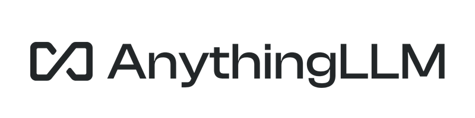
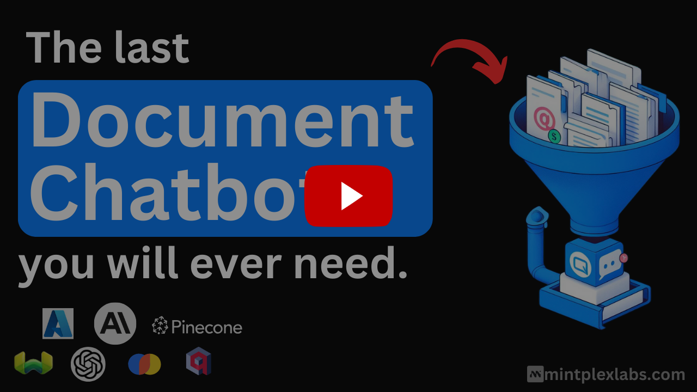

  

    <b>AnythingLLM:</b> Aradığınız hepsi bir arada yapay zekâ uygulaması. 
    Belgelerinizle sohbet edin, yapay zekâ ajanlarını kullanın. Kapsamlı yapılandırma ve çoklu kullanıcı desteği; zahmetsiz kurulum.

   |
   |
   |
  <a href="https://docs.anythingllm.com" target="_blank">
    Belgeler
  </a> |
   <a href="https://my.mintplexlabs.com/aio-checkout?product=anythingllm" target="_blank">
    Barındırılan Kurulum
  </a>

  <a href='../README.md'>English</a> · <a href='./README.zh-CN.md'>简体中文</a> · <a href='./README.ja-JP.md'>日本語</a> · <b>Türkçe</b> · <a href='./README.fa-IR.md'>فارسی</a>

👉 Masaüstü için AnythingLLM (Mac, Windows ve Linux)! <a href="https://anythingllm.com/download" target="_blank"> Hemen indirin</a>

📱 AnythingLLM Mobile (Android) açık kaynaklıdır! <a href="https://github.com/Mintplex-Labs/anythingllm-mobile" target="_blank">Depoyu görüntüleyin</a>

Belgelerinizle sohbet edin. Karmaşık iş akışlarını yapay zekâ ajanlarıyla otomatikleştirin. Kapsamlı yapılandırma seçenekleri ve çoklu kullanıcı desteği sunan, gerçek kullanımda kendini kanıtlamış AnythingLLM, varsayılan olarak yerel ortamınızda çalışır ve zahmetsizce kurulur.

<kbd>Demoyu izleyin!</kbd>

### Ürüne Genel Bakış

AnythingLLM, gizliliğinizden veya özelliklerden ödün vermeden kendi ChatGPT deneyiminizi oluşturmanızı sağlayan, hepsi bir arada bir yapay zekâ uygulamasıdır. Tercih ettiğiniz yerel veya bulut tabanlı büyük dil modelini (LLM) bağlayın, belgelerinizi yükleyin ve dakikalar içinde sohbete başlayın. Yerleşik ajanlar, çoklu kullanıcı desteği, vektör veritabanları ve belge işleme hatları ek yapılandırma gerektirmeden kullanıma hazırdır.

AnythingLLM, kurulumunuzun güvenliğinden, gizliliğinden veya fikrî mülkiyet haklarınızdan ödün vermeden her kullanıcının erişimini ve deneyimini ayrı ayrı yönetebileceğiniz çoklu kullanıcı desteği sunar.

## AnythingLLM'nin Öne Çıkan Özellikleri

- [Yerleşik yerel LLM motoru](../docker/HOW_TO_USE_DOCKER.md#built-in-llm-engine-optional) - [Lemonade](https://lemonade-server.ai) ve [llama.cpp](https://github.com/ggml-org/llama.cpp) sayesinde yerel modelleri ek kurulum yapmadan CPU veya GPU üzerinde çalıştırın (NVIDIA için CUDA, AMD ve Intel için Vulkan).
- [Dinamik Model Yönlendirme](https://docs.anythingllm.com/model-router/overview) - Tanımladığınız kurallara göre sohbetleri konuşmaya en uygun sağlayıcıya ve modele otomatik olarak yönlendirin.
- [Otomatik ve Kullanıcı Tarafından Yönetilen Anılar](https://docs.anythingllm.com/features/memories) - LLM'nizin siz veya çalışma alanınız hakkındaki önemli bilgileri hatırlamasını sağlayın.
- [Zamanlanmış Görevler](https://docs.anythingllm.com/scheduled-jobs/overview) - Yinelenen görevleri veya istemleri tüm ajan yetenekleriyle bir cron zamanlamasına göre çalıştırın.
- [Akıllı Beceri Seçimi](https://docs.anythingllm.com/agent/intelligent-tool-selection) - Modelleriniz için **sınırsız** sayıda aracı etkinleştirirken sorgu başına token kullanımını %80'e kadar azaltın.
- [Kod yazmadan yapay zekâ ajanı oluşturma](https://docs.anythingllm.com/agent-flows/overview)
- [MCP uyumluluğu](https://docs.anythingllm.com/mcp-compatibility/overview)
- [Çok modlu model desteği (hem kapalı hem açık kaynaklı LLM'ler!)](https://docs.anythingllm.com/features/language-models)
- [Özel Yapay Zekâ Ajanları](https://docs.anythingllm.com/agent/custom/introduction)
- 👤 Çoklu kullanıcı ve yetkilendirme desteği. _Yalnızca Docker sürümünde._
- 🎨 [Özel renk temaları ve kendi markanızla kullanım](https://docs.anythingllm.com/features/branding) - True Dark gibi yerleşik bir palet seçin veya marka renklerinizle kendi paletinizi oluşturup kurulumunuzdaki tüm kullanıcılara uygulayın. _Yalnızca Docker sürümünde._
- 🦾 Çalışma alanınızda ajanlar (web'de gezinme ve daha fazlası).
- 💬 [Web sitenize ekleyebileceğiniz özelleştirilebilir sohbet bileşeni](https://github.com/Mintplex-Labs/anythingllm-embed/blob/main/README.md). _Yalnızca Docker sürümünde._
- 📖 Birden fazla belge türü desteği (PDF, TXT, DOCX vb.).
- Sürükleyip bırakarak dosya yükleme ve kaynak gösterme özelliklerine sahip, kullanımı kolay sohbet arayüzü.
- Her türlü bulut dağıtımında üretim ortamına hazır.
- Tüm popüler [kapalı ve açık kaynaklı LLM sağlayıcılarıyla](#supported-llms-embedder-models-speech-models-and-vector-databases) çalışır.
- Büyük belge koleksiyonları için yerleşik optimizasyonlar: diğer sohbet arayüzlerine kıyasla daha düşük maliyet ve daha hızlı yanıtlar.
- Özel entegrasyonlar için kapsamlı geliştirici API'si!
- ...ve çok daha fazlası. Dakikalar içinde kurun ve kendiniz keşfedin.

### Desteklenen LLM'ler, Vektörleştirme Modelleri, Konuşma Modelleri ve Vektör Veritabanları

**Büyük Dil Modelleri (LLM'ler):**

- [llama.cpp uyumlu herhangi bir açık kaynaklı model](../server/storage/models/README.md#text-generation-llm-selection)
- [OpenAI](https://openai.com)
- [OpenAI (Genel)](https://openai.com)
- [Azure OpenAI](https://azure.microsoft.com/en-us/products/ai-services/openai-service)
- [AWS Bedrock](https://aws.amazon.com/bedrock/)
- [Anthropic](https://www.anthropic.com/)
- [NVIDIA NIM (sohbet modelleri)](https://build.nvidia.com/explore/discover)
- [Google Gemini Pro](https://ai.google.dev/)
- [Ollama (sohbet modelleri)](https://ollama.ai/)
- [LM Studio (tüm modeller)](https://lmstudio.ai)
- [LocalAI (tüm modeller)](https://localai.io/)
- [Together AI (sohbet modelleri)](https://www.together.ai/)
- [Fireworks AI (sohbet modelleri)](https://fireworks.ai/)
- [Perplexity (sohbet modelleri)](https://www.perplexity.ai/)
- [OpenRouter (sohbet modelleri)](https://openrouter.ai/)
- [DeepSeek (sohbet modelleri)](https://deepseek.com/)
- [Mistral](https://mistral.ai/)
- [Groq](https://groq.com/)
- [Cohere](https://cohere.com/)
- [KoboldCPP](https://github.com/LostRuins/koboldcpp)
- [LiteLLM](https://github.com/BerriAI/litellm)
- [Text Generation Web UI](https://github.com/oobabooga/text-generation-webui)
- [Apipie](https://apipie.ai/)
- [xAI](https://x.ai/)
- [Z.AI (sohbet modelleri)](https://z.ai/model-api)
- [Novita AI (sohbet modelleri)](https://novita.ai/model-api/product/llm-api?utm_source=github_anything-llm&utm_medium=github_readme&utm_campaign=link)
- [PPIO](https://ppinfra.com?utm_source=github_anything-llm)
- [Gitee AI](https://ai.gitee.com/)
- [Moonshot AI](https://www.moonshot.ai/)
- [Microsoft Foundry Local](https://learn.microsoft.com/en-us/azure/ai-foundry/foundry-local/)
- [CometAPI (sohbet modelleri)](https://www.cometapi.com/)
- [llmman](https://github.com/llmmanorg/llmman)
- [PrivateModeAI (sohbet modelleri)](https://privatemode.ai/)
- [SambaNova Cloud (sohbet modelleri)](https://cloud.sambanova.ai/)
- [Lemonade by AMD](https://lemonade-server.ai)
- [Minimax](https://platform.minimax.io)
- [Cerebras (sohbet modelleri)](https://www.cerebras.ai/)
- [oMLX](https://github.com/jundot/omlx)

**Vektörleştirme modelleri:**

- [AnythingLLM'nin Yerleşik Vektörleştirme Modeli](../server/storage/models/README.md) (varsayılan)
- [OpenAI](https://openai.com)
- [Azure OpenAI](https://azure.microsoft.com/en-us/products/ai-services/openai-service)
- [Gemini](https://ai.google.dev/)
- [LocalAI (tümü)](https://localai.io/)
- [Ollama (tümü)](https://ollama.ai/)
- [LM Studio (tümü)](https://lmstudio.ai)
- [Lemonade](https://lemonade-server.ai)
- [OpenRouter](https://openrouter.ai/)
- [LiteLLM](https://github.com/BerriAI/litellm)
- [Cohere](https://cohere.com/)
- [Voyage AI](https://www.voyageai.com/)
- [Mistral](https://mistral.ai/)
- Genel OpenAI uyumlu vektörleştirme API'leri

**Ses kaydını metne dönüştürme modelleri:**

- [AnythingLLM'nin Yerleşik Modeli](https://github.com/Mintplex-Labs/anything-llm/tree/master/server/storage/models#audiovideo-transcription) (varsayılan)
- [OpenAI](https://openai.com/)

**Metinden konuşmaya (TTS) desteği:**

- Tarayıcının yerleşik özelliği (varsayılan)
- [PiperTTSLocal - tarayıcıda çalışır](https://github.com/rhasspy/piper)
- [OpenAI TTS](https://platform.openai.com/docs/guides/text-to-speech#voice-options)
- [ElevenLabs](https://elevenlabs.io/)
- OpenAI uyumlu herhangi bir TTS hizmeti.

**Konuşmadan metne (STT) desteği:**

- Tarayıcının yerleşik özelliği (varsayılan)

**Vektör Veritabanları:**

- [LanceDB](https://github.com/lancedb/lancedb) (varsayılan)
- [PGVector](https://github.com/pgvector/pgvector)
- [Astra DB](https://www.datastax.com/products/datastax-astra)
- [Pinecone](https://pinecone.io)
- [Chroma & ChromaCloud](https://trychroma.com)
- [Weaviate](https://weaviate.io)
- [Qdrant](https://qdrant.tech)
- [Milvus](https://milvus.io)
- [Zilliz](https://zilliz.com)

### Teknik Genel Bakış

Bu monorepo altı ana bölümden oluşur:

- `frontend`: LLM'nin kullanabileceği tüm içerikleri kolayca oluşturup yönetmenizi sağlayan, ViteJS ve React ile geliştirilmiş ön yüz.
- `server`: Tüm etkileşimleri, vektör veritabanı yönetimini ve LLM iletişimini yürüten NodeJS Express sunucusu.
- `collector`: Arayüzden gelen belgeleri işleyen ve ayrıştıran NodeJS Express sunucusu.
- `docker`: Docker yönergeleri, derleme süreci ve kaynak koddan derleme bilgileri.
- `embed`: [Web'e gömülebilir sohbet bileşenini](https://github.com/Mintplex-Labs/anythingllm-embed) oluşturmak için kullanılan alt modül.
- `browser-extension`: [Chrome tarayıcı uzantısının](https://github.com/Mintplex-Labs/anythingllm-extension) alt modülü.

## 🛳 Kendi Sunucunuzda Barındırma

Mintplex Labs ve topluluk, AnythingLLM'yi yerel ortamınızda çalıştırmak için kullanabileceğiniz çeşitli dağıtım yöntemleri, betikler ve şablonlar sunar. Tercih ettiğiniz ortamın kurulum yönergelerine ulaşmak veya otomatik dağıtım başlatmak için aşağıdaki tabloya bakın.
| Docker | AWS | GCP | Digital Ocean | Render.com |
|----------------------------------------|----|-----|---------------|------------|
| [![Docker üzerinde dağıt][docker-btn]][docker-deploy] | [![AWS üzerinde dağıt][aws-btn]][aws-deploy] | [![GCP üzerinde dağıt][gcp-btn]][gcp-deploy] | [![DigitalOcean üzerinde dağıt][do-btn]][do-deploy] | [![Render.com üzerinde dağıt][render-btn]][render-deploy] |

| Railway                                             | RepoCloud                                                 | Elestio                                             | Northflank                                                   | Sealos                                           |
| --------------------------------------------------- | --------------------------------------------------------- | --------------------------------------------------- | ------------------------------------------------------------ | ------------------------------------------------ |
| [![Railway üzerinde dağıt][railway-btn]][railway-deploy] | [![RepoCloud üzerinde dağıt][repocloud-btn]][repocloud-deploy] | [![Elestio üzerinde dağıt][elestio-btn]][elestio-deploy] | [![Northflank üzerinde dağıt][northflank-btn]][northflank-deploy] | [![Sealos üzerinde dağıt][sealos-btn]][sealos-deploy] |

| Easypanel                                                 |
| --------------------------------------------------------- |
| [![Easypanel üzerinde dağıt][easypanel-btn]][easypanel-deploy] |

[Ya da Docker kullanmadan üretim ortamı için AnythingLLM kurulumu yapın →](../BARE_METAL.md)

## Geliştirme Ortamını Kurma

- Depo kök dizininde `yarn setup` komutunu çalıştırarak uygulamanın her bölümü için gerekli `.env` dosyalarını oluşturun.
  - Devam etmeden önce bu dosyaları doldurun. Özellikle `server/.env.development` dosyasını yapılandırın; aksi hâlde uygulama düzgün çalışmaz.
- Sunucuyu yerel ortamda başlatmak için depo kök dizininde `yarn dev:server` komutunu çalıştırın.
- Ön yüzü yerel ortamda başlatmak için depo kök dizininde `yarn dev:frontend` komutunu çalıştırın.
- Ardından belge toplayıcısını çalıştırmak için depo kök dizininde `yarn dev:collector` komutunu çalıştırın.

[Belgeler hakkında bilgi edinin](../server/storage/documents/DOCUMENTS.md)

## Telemetri ve Gizlilik

Mintplex Labs Inc tarafından geliştirilen AnythingLLM, anonim kullanım bilgileri toplayan bir telemetri özelliği içerir.

<kbd>More about Telemetry & Privacy for AnythingLLM</kbd>

### Neden?

Bu bilgileri AnythingLLM'nin nasıl kullanıldığını anlamak, yeni özellikler ve hata düzeltmelerini önceliklendirmek, performansı ve kararlılığı iyileştirmek için kullanıyoruz.

### Telemetriyi devre dışı bırakma

Telemetriyi kapatmak için sunucu veya Docker `.env` ayarlarınızda `DISABLE_TELEMETRY=true` değerini kullanın. Bunu uygulama içinde kenar çubuğundaki `Gizlilik` bölümünden telemetriyi devre dışı bırakarak da yapabilirsiniz.

### Tam olarak neleri takip ediyorsunuz?

Yalnızca ürün ve yol haritası kararlarımızı destekleyen şu kullanım bilgilerini takip ediyoruz:

- Kurulum türünüz (Docker veya Masaüstü).

- Bir belgenin eklenmesi veya kaldırılması. Belgenin _içeriğiyle ilgili hiçbir bilgi_ toplanmaz; yalnızca olayın gerçekleştiği kaydedilir. Bu, kullanım hakkında fikir edinmemizi sağlar.

- Kullanılan vektör veritabanının türü. Bu, ilgili sağlayıcının güncellemeleri için gerekli değişiklikleri önceliklendirmemizi sağlar.

- Kullanılan LLM sağlayıcısı ve model etiketi. Bu, sağlayıcıya, modele veya ikisinin birleşimine yönelik güncellemeleri önceliklendirmemizi sağlar. Örneğin, akıl yürütme modelleri, standart modeller ve çok modlu modeller.

- Bir sohbet mesajının gönderilmesi. En sık gerçekleşen bu olay, tüm kurulumlardaki günlük etkinlik hakkında fikir verir. Yalnızca **olay** gönderilir; sohbetin niteliği veya içeriği hakkında hiçbir bilgi toplanmaz.

Bu açıklamaları doğrulamak için `Telemetry.sendTelemetry` çağrılarının yapıldığı tüm yerleri inceleyebilirsiniz. Telemetri etkinse olaylar çıktı günlüğüne de yazılır; böylece gönderilen verileri görebilirsiniz. **IP adresi veya kimliğinizi belirleyebilecek başka hiçbir bilgi toplanmaz**. Telemetri sağlayıcısı, açık kaynaklı bir telemetri toplama hizmeti olan [PostHog](https://posthog.com/)'dur.

Gizliliği çok ciddiye alıyoruz. Can sıkıcı açılır anketler kullanmadan aracımızın nasıl kullanıldığını öğrenerek kullanmaya değer bir ürün geliştirmek istiyoruz. Anonim veriler üçüncü taraflarla _asla_ paylaşılmaz.

[Kaynak koddaki tüm telemetri olaylarını görüntüleyin](https://github.com/search?q=repo%3AMintplex-Labs%2Fanything-llm%20.sendTelemetry%28&type=code)

### Diğer dış bağlantılar

Telemetriyi devre dışı bıraksanız bile aşağıdaki hizmetlere giden bağlantılar görebilirsiniz:

- Harici bir araç, LLM, vektörleştirme modeli veya vektör veritabanı kullanıyorsanız ilgili hizmet sağlayıcısına giden bağlantılar devam eder.
- Modelleri yansı CDN sunucumuzdan indirmek için `cdn.anythingllm.com` kullanılır. Bu bağlantılar telemetriyle takip edilmez ve VPN kısıtlamalarının bulunduğu bölgelerde yararlıdır.
- `github/githubusercontent.com`: Bağlam penceresi bilgilerinin önbelleğe alınması için bu alan adlarından çeşitli düz dosyalar indirilir.

Telemetri devre dışıysa hiçbir veri toplamıyoruz. Ancak yapılandırmanıza bağlı olarak dış bağlantılar görebilirsiniz ve ilgili hizmet sağlayıcısının kullanım koşullarına tabi olabilirsiniz.

## 👋 Katkıda Bulunma

- [AnythingLLM'ye katkıda bulunma](../CONTRIBUTING.md) - Katkı sağlama yönergeleri.

## 💖 Sponsorlar

<!--
### Premium Sponsors
premium-sponsors (reserved for $100/mth sponsors who request to be called out here and/or are non-private sponsors) -->
<!-- premium-sponsors -->

### Tüm Sponsorlar

<!-- all-sponsors --><!-- all-sponsors -->

## 🌟 Katkıda Bulunanlar

## 🔗 Diğer Ürünler

- **[AnythingLLM Mobile (Açık Kaynak Lisanslı)][anythingllm-mobile]:** Aynı cihaz üzerinde çalışan AnythingLLM deneyimi, bu kez telefonunuzda.
- **[AnythingLLM Tarayıcı Uzantısı][anythingllm-extension]:** AnythingLLM'yi tarayıcınızda kullanmanızı sağlayan uzantı.
- **[AnythingLLM Embed][anythingllm-embed]:** AnythingLLM'yi web sitenize eklemenizi sağlayan sohbet bileşeni.
- **[Open Computer][open-computer]:** Yapay zekâ ajanlarının kullanabileceği eksiksiz bir bilgisayar ortamı.

[![][back-to-top]](#readme-top)

---

Telif hakkı © 2026 [Mintplex Labs][profile-link].  
Bu proje [MIT](../LICENSE) lisansıyla sunulmaktadır.

<!-- LINK GROUP -->

[back-to-top]: https://img.shields.io/badge/-BAŞA_DÖN-222628?style=flat-square
[profile-link]: https://github.com/mintplex-labs
[anythingllm-mobile]: https://github.com/Mintplex-Labs/anythingllm-mobile
[anythingllm-extension]: https://github.com/Mintplex-Labs/anythingllm-extension
[anythingllm-embed]: https://github.com/Mintplex-Labs/anythingllm-embed
[open-computer]: https://github.com/Mintplex-Labs/open-computer
[docker-btn]: ../images/deployBtns/docker.png
[docker-deploy]: ../docker/HOW_TO_USE_DOCKER.md
[aws-btn]: ../images/deployBtns/aws.png
[aws-deploy]: ../cloud-deployments/aws/cloudformation/DEPLOY.md
[gcp-btn]: https://deploy.cloud.run/button.svg
[gcp-deploy]: ../cloud-deployments/gcp/deployment/DEPLOY.md
[do-btn]: https://www.deploytodo.com/do-btn-blue.svg
[do-deploy]: ../cloud-deployments/digitalocean/terraform/DEPLOY.md
[render-btn]: https://render.com/images/deploy-to-render-button.svg
[render-deploy]: https://render.com/deploy?repo=https://github.com/Mintplex-Labs/anything-llm&branch=render
[render-btn]: https://render.com/images/deploy-to-render-button.svg
[render-deploy]: https://render.com/deploy?repo=https://github.com/Mintplex-Labs/anything-llm&branch=render
[railway-btn]: https://railway.app/button.svg
[railway-deploy]: https://railway.app/template/HNSCS1?referralCode=WFgJkn
[repocloud-btn]: https://d16t0pc4846x52.cloudfront.net/deploylobe.svg
[repocloud-deploy]: https://repocloud.io/details/?app_id=276
[elestio-btn]: https://elest.io/images/logos/deploy-to-elestio-btn.png
[elestio-deploy]: https://elest.io/open-source/anythingllm
[northflank-btn]: https://assets.northflank.com/deploy_to_northflank_smm_36700fb050.svg
[northflank-deploy]: https://northflank.com/stacks/deploy-anythingllm
[sealos-btn]: https://sealos.io/Deploy-on-Sealos.svg
[sealos-deploy]: https://sealos.io/products/app-store/anything-llm
[easypanel-btn]: https://easypanel.io/img/deploy-on-easypanel-40.svg
[easypanel-deploy]: https://easypanel.io/templates/anythingllm
